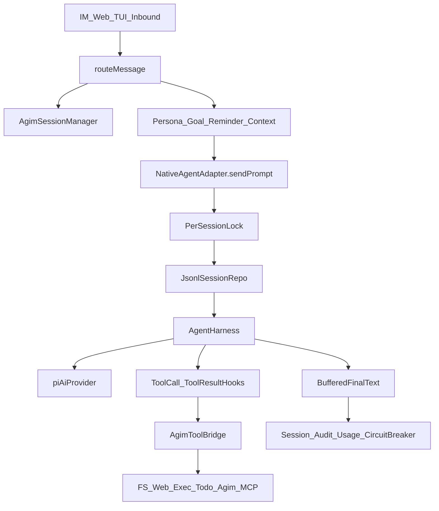
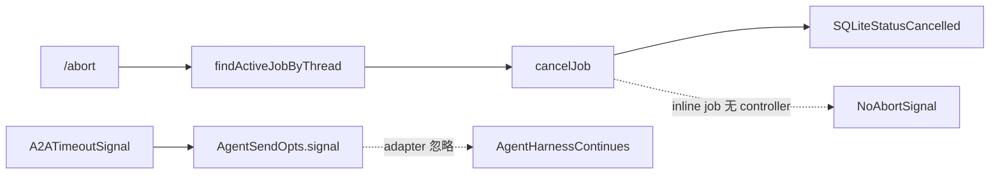
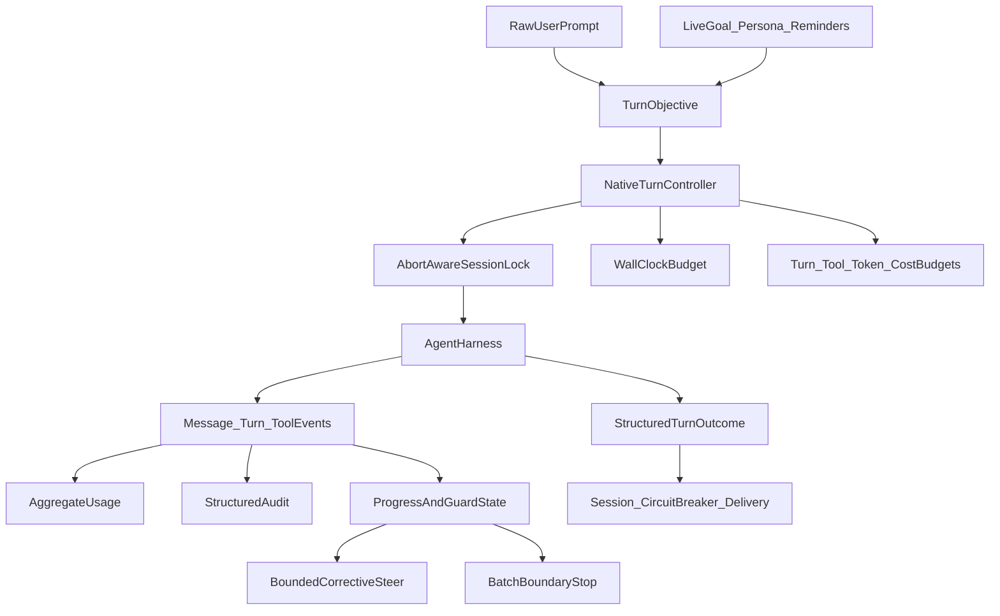

# Agim 内置 pi-agent loop 优化分析

> 基线：`origin/main@ed7518d3`（Agim `1.5.12`）
> 分析日期：2026-07-13
> 范围：内置 Agim Agent（`native` / `agim`，基于 `@earendil-works/pi-agent-core`），不包含外置 PI CLI 的内部 loop。
> 本文只给出分析、验证证据和后续实施拆分，不修改运行时行为。

## 1. 结论摘要

当前生产 loop 的主路径是 [`NativeAgentAdapter`](../src/plugins/agents/pi-native/index.ts)，实际循环由 `@earendil-works/pi-agent-core@0.79.8` 的 `AgentHarness` 执行。仓库中的 [`runAgentLoop`](../src/core/llm/agent-loop.ts) 已退役为库与测试参考，不能用它的测试通过情况推断生产 `pi-native` 具备相同行为。

最优先的问题不是继续堆提示词，而是先修复六个确定性控制与数据缺口：

1. **Plan Mode 硬阻断使用了错误的写工具名**：默认 deny 集合包含 `native_write`，实际工具名是 `native_write_file`。运行探针证明只设置 `opts.planMode=true` 时写工具仍会执行。
2. **取消链路断裂**：inline job 没有绑定 `AbortController`，router 不传 signal，`NativeAgentAdapter` 也不消费 `opts.signal`；即使 signal 已触发，忽略 signal 的工具仍会跑到完成或工具超时。
3. **max-iteration / stuck-loop 在批量或 preflight 失败时不能可靠终止**：pi 只在一个 batch 的所有结果都返回 `terminate:true` 时停止；validation/policy/unknown-tool 的 immediate result 又不经过当前 `tool_result` hook。预算既可被批量调用越过，也可被连续无效调用完全绕过。
4. **没有整轮 wall timeout**：`AGIM_NATIVE_REQUEST_TIMEOUT_MS` 只限制单次 provider 请求，不限制一个包含多轮 LLM 与工具调用的 turn。
5. **冷 session 首轮 prompt 双写**：router 先把当前 prompt push 到被传入的 history 引用，fresh pi session 随后 seed 这份 history，又调用一次 `harness.prompt()`；模型和 JSONL 都看到两条当前 user turn。
6. **pi JSONL 权限与生命周期没有接入 Agim session 管理**：典型 `umask 022` 下探针得到目录 `0755`、文件 `0644`；`/new` 与 session TTL 清理也不会删除旧 pi JSONL。

影响目标达成质量的下一层问题是：

- 多轮 usage 只上报最后一次模型调用，且手工构造的 model cost 全为 0，成本与 token 指标系统性低估。
- provider 失败被转换成普通文本，router/circuit breaker 会把失败记作成功。
- goal/persona/reminder 等动态上下文被作为 user prompt 写入 pi JSONL，每轮重复持久化，长期会话会积累过期或重复指令。
- 当前 exact stuck-loop 可被 JSON key 顺序绕过；跨工具语义重复、空回复、长度截断和“口述调用工具但未调用”均无生产恢复路径。
- `/goal`、todo 和 verifier 提示已经存在，但没有形成“目标 → 计划 → 证据 → 完成判定”的 loop 契约；`complete_goal` 仍完全依赖模型自觉。

一个重要的反向结论：**不要在 pi-native 再实现一套 tool schema validator**。`pi-agent-core@0.79.8` 已在 tool preflight 中调用 `pi-ai` 的 `validateToolArguments()`；运行探针确认缺少 required 参数时 dispatcher 不会执行，并会向模型注入结构化校验错误。

## 2. 范围与术语

Agim 中有两条名称容易混淆的路径：

| 产品路径 | 注册名 | 实现 | loop 归属 |
|---|---|---|---|
| 内置 Agim Agent | `native`、`agim`、`na`、`llm` | [`src/plugins/agents/pi-native/`](../src/plugins/agents/pi-native/) | Agim 进程内的 `AgentHarness` |
| 外置 PI CLI | `pi`、`pi-agent` | [`src/plugins/agents/pi/`](../src/plugins/agents/pi/) | 外部 `pi --mode json` 子进程 |

本文的“pi-agent loop”专指第一条路径。外置 PI CLI 的内部停止条件、重试和上下文策略不在 Agim 控制范围内。

## 3. 当前生产数据流



关键契约：

- [`callAgentWithHistory()`](../src/core/router.ts) 先把原始 user prompt 写入 Agim session，再把动态上下文拼到 prompt 前面交给 adapter。
- [`NativeAgentAdapter`](../src/plugins/agents/pi-native/index.ts) 每个 turn 新建一个 `AgentHarness`，但复用同一个 `sessionId` 对应的 JSONL。
- 冷 session 才从 Agim history seed；热 session 以 pi JSONL 为 loop 历史真源。
- 同 session 通过 `sessionLocks` 串行；不同 session 可并发。
- [`tool-bridge.ts`](../src/plugins/agents/pi-native/tool-bridge.ts) 把 Agim dispatcher 错误翻译成 throw，并提供工具超时和结果截断。
- 当前只在 `harness.prompt()` 完成后 yield 一次最终文本；token delta 没有接入 adapter。

### 3.1 已经有效的能力

以下能力有生产代码和运行测试支撑，应保留：

| 能力 | 当前实现 | 验证状态 |
|---|---|---|
| 同 session 串行 | `sessionLocks` | 定向测试通过 |
| 跨 session 并行 | per-key lock | 定向测试通过 |
| JSONL 持久化 | `JsonlSessionRepo` | 新建 adapter 后恢复成功 |
| Plan/policy hook | `tool_call` + approval gate | policy 测试存在，但默认硬阻断工具名有缺陷 |
| Provider 请求重试/超时 | `AgentHarnessStreamOptions` | 只覆盖单次请求 |
| 工具超时 | `dispatchWithTimeout()` | 定向测试通过 |
| 工具结果截断 | `AGIM_NATIVE_TOOL_RESULT_MAX_CHARS` | 定向测试通过 |
| 上下文压缩 | turn 前 `harness.compact()` | 定向测试通过 |
| 参数 schema 校验 | pi 上游 `validateToolArguments()` | 运行探针确认 dispatcher 未执行 |
| 空结果/错误可见提示 | adapter recap/notice | 定向测试通过 |

## 4. 运行验证

### 4.1 基线测试

定向测试：

```text
./node_modules/.bin/bun test --isolate \
  src/plugins/agents/pi-native/index.test.ts \
  src/plugins/agents/pi-native/tool-bridge.test.ts \
  src/plugins/agents/pi-native/provider-resolver.test.ts \
  src/plugins/agents/pi-native/pi-runtime.smoke.test.ts \
  src/core/goals.test.ts src/core/goal-rpc.test.ts \
  test/unit/call-agent-v1-2-139.test.ts \
  test/unit/job-board-inline.test.ts \
  test/unit/job-board-concurrency.test.ts \
  test/unit/job-recovery.test.ts
```

结果：`74 pass / 16 skip / 0 fail`。16 个 skip 均为 Bun 不支持 `better-sqlite3` 的预期跳过。

真实 SQLite Node pool：

```text
npm run test:sqlite
```

结果：`16 files / 261 tests passed`。

### 4.2 定向运行探针

所有探针均使用仓库已依赖的 faux provider，不访问真实 LLM。

| 场景 | 输入/控制 | 实际结果 | 结论 |
|---|---|---|---|
| 外部取消 | 20ms 后 abort，provider 220ms 返回 | `elapsedMs=234`，仍输出 `completed-after-abort` | `opts.signal` 未接入 harness |
| 工具取消 | 20ms 后 abort，工具忽略 signal、220ms 返回 | `elapsedMs=221`，仍返回 `late` | tool bridge 没有 outer-abort race |
| 请求超时 vs turn 超时 | 每次 provider 60ms，request timeout 100ms，3 次工具调用 | 总耗时 `262ms` 且正常完成 | request timeout 不是 turn watchdog |
| Plan Mode 写操作 | `planMode=true`，调用真实工具名 `native_write_file` | `dispatchCount=1` | 默认 hard deny 名称错误 |
| 批量工具预算 | `maxIterations=3`，连续两个 batch、每批 3 calls | `dispatchCount=6` | batch terminate 语义使上限失效 |
| Preflight 失败预算 | `maxIterations=2`，连续 5 次缺 required 参数 | `providerCalls=6`、`dispatchCount=0` | validation immediate result 不进入当前计数 hook |
| 参数 key 顺序 | 同工具/同值，参数 key 顺序交替 | 4 次后因 max_iter 停止 | `JSON.stringify` 指纹可被顺序绕过 |
| 跨工具语义重复 | 3 个 search 工具使用同一长 query | 未在第 3 次停止，继续到 max_iter | 无语义/进展检测 |
| Schema 缺 required | tool 要求 `command`，模型传 `{}` | `dispatchCount=0`，模型收到 validation error | 上游已正确校验，勿重复实现 |
| 幻觉工具调用 | 文本声称“调用 native_write_file”，无真实 call | 原文本直接返回用户 | detector 未接入生产路径 |
| 空回复 | 第一次空，队列中有可恢复的第二响应 | `providerCalls=1`，返回空回复 recap | 无 bounded blank retry |
| 长度截断 | 第一次 `stopReason=length`，队列中有续写 | `providerCalls=1`，只返回 `partial` | 无 bounded continuation |
| 多轮 usage | 1 次工具轮 + 1 次最终轮 | callback `59/3`；JSONL 聚合 `114/6` | 只上报最后一轮 |
| 进程内“重启”恢复 | 新 adapter、相同 sessionsRoot/sessionId | 第二轮看到 2 条 user message | JSONL 恢复基础可用 |
| 动态上下文持久化 | 两轮都带 active-goal header | JSONL 中 header 出现 `2/2` | 临时上下文被重复存入 durable history |
| Router 冷 session | 真实 `callAgentWithHistory()` 首轮 | `userMessageCount=2`、两条都是当前 prompt | 当前 turn 被 seed + prompt 双写 |
| pi session 权限 | `umask 022` 下创建 session | 目录 `0755`、JSONL `0644` | 缺少明确的 `0700/0600` 防护；Agim 主 session 也需补目录 mode |

### 4.3 环境限制

分析 VM 为 Node `22.14.0`，而 Agim 与 pi 包声明 `>=22.19.0`。依赖安装产生 engine warning，但上述 Bun 与 Node/Vitest SQLite 测试均通过。正式实现与发布门禁应使用满足 engine 的 Node 版本重新验证。

## 5. 发现与优先级

### P0：控制正确性与安全边界

#### P0-1 Plan Mode 的硬阻断工具名漂移

[`pi-native/index.ts`](../src/plugins/agents/pi-native/index.ts) 当前默认集合：

```text
native_write
native_exec
```

真实文件写工具由 [`fs-dispatcher.ts`](../src/core/llm/fs-dispatcher.ts) 注册为：

```text
native_write_file
```

现有测试使用不存在的 `native_write`，因此测试通过但没有覆盖真实工具名。这个探针证明的是“仅依赖 transient `opts.planMode` 的 adapter 路径”可写；持久 `/plan on` 的标准 IM 路径通常还有正确包含 `native_write_file` 的 policy denyList。以下路径仍依赖 adapter 的硬阻断：

- A2A 传播的是本 turn 的临时 plan flag，而持久 plan state 可能仍是 off。
- heuristic auto-enter 只对当前 turn 生效。
- 无 IM notifier、直接 adapter 调用或未来新增入口。

Plan Mode 目前还有两个契约问题：

- router 的 `AGIM_DISABLE_PLAN_MODE` kill switch 只修改本次 `effectivePlanMode`；system prompt 与 policy 使用的 `effectivePlanModeOn()` 不读取该 kill switch，状态可能互相矛盾。
- 产品必须先明确 Plan Mode 是“只禁止本地文件写入/执行”，还是“禁止一切副作用”。若是后者，memo、reminder、goal、push、todo、`call_agent` 与 external MCP 也必须纳入 side-effect policy；仅列两个工具不够。`native_exit_plan_mode` 本身会修改 plan state，但又必须在 Plan Mode 内可调用，证明“有副作用”与“Plan Mode 禁止”不是同一维度。
- `native_exit_plan_mode` 目前复用通用 approval bus；默认 `AGIM_AUTO_APPROVE=1` 可直接 allow，模型可能自动关闭用户设置的 Plan Mode，而不是等待用户确认。

建议：

1. 立即修正真实工具名并加入回归测试。
2. 在实现通用 metadata 前先固化规范矩阵：每个内置工具、MCP、A2A、unknown tool 与 plan-exit 分别是 `allow`、`deny` 还是 `approvalOnly`；验收只要求被该矩阵禁止的 dispatch 为 0。
3. 让 router 的每轮 effective Plan Mode 成为唯一真源，system prompt、policy gate、A2A 与 adapter hard deny 都消费同一个值。
4. 不再在 adapter、policy 和 tool registry 复制字符串集合；给工具定义增加三个**独立**维度：
   - `sideEffectClass: read | mutate | unknown`，用于 Plan/policy。
   - `planModeAccess: allow | deny | approvalOnly`，表达 plan-exit 等受控状态变化。
   - `concurrencyClass: parallel | serial`，用于执行调度。只读不等于可并行，后者继续默认 `serial`。
5. 外部 MCP 的 `readOnlyHint` 只能作为不可信提示；Plan Mode 下 unknown 默认 fail closed。`call_agent` 只能委派给明确声明支持 Plan Mode 的 adapter。
6. 明确 `native_exit_plan_mode` 批准后的生效边界：当前 turn 静态 `opts.planMode` 与已构建 gate 不能继续错误阻断后续执行，也不能在未批准前提前放开。
7. `approvalOnly` 必须强制显式用户确认，不受 auto-approve、auto-allow 或 allow-on-timeout 影响；默认配置下模型不得自动退出 Plan Mode。

#### P0-2 取消链路没有闭环

当前链路：



具体断点：

- [`job-board.ts`](../src/core/job-board.ts) 的 `runningControllers` 只在 `runJob()` 注册。
- [`cli.ts`](../src/cli.ts) 的 inline path 只调用 `markJobRunning()`。
- [`router.ts`](../src/core/router.ts) 没有把 inline signal 放入 `AgentSendOpts`。
- [`NativeAgentAdapter`](../src/plugins/agents/pi-native/index.ts) 不读取 `opts.signal`。
- `AgentHarness.prompt()` 不接收 signal，但 `AgentHarness.abort()` 已提供正确的内部取消入口。
- `dispatchWithTimeout()` 在 outer abort 时只 abort 子 controller；若 dispatcher 不合作，Promise 仍等到工具完成或 timeout。
- `findActiveJobByThread()` 把 `running` 与 `pending` 混在一起按创建时间倒序；一个 turn 正在运行、后面又排了消息时，`/abort` 可能取消较新的 pending，而不是当前运行项。
- [`thread-queue.ts`](../src/core/thread-queue.ts) 没有取消 queue entry 的能力；被标记 cancelled 的 pending closure 之后仍会执行。`runJob()` 在等待并发 slot 后也不复查状态。
- schedule、显式 `/job run` 与 Web job 虽然各自拿到了 signal，但调用 adapter 时没有统一传递。
- `harness.abort()` 只影响已经创建的内部 run controller，不能锁存“在 harness/provider 尚未启动前发生的取消”。
- turn 前的 `harness.compact()` 使用独立 signal；approval gate 也没有 signal 参数。仅监听 `opts.signal` 后调用 `harness.abort()`不能覆盖完整 turn。

影响：

- 用户收到“已中止”后，模型/工具仍继续运行并可能发送最终回复。
- A2A timeout 后 native 子 agent 继续消耗 token、写文件或占用 session lock。
- 同 session 后续消息被挂起 turn 阻塞。

建议建立单一 `NativeTurnController`：

1. inline job 创建时同时创建并注册 controller；`cancelJob()` 只负责触发它，不提前删除 active binding。
2. `/abort` 优先定位 `running`；“同时清空本线程 queued turns”必须是显式、可测试的产品语义。thread queue entry 携带 signal，并在真正执行前 CAS 检查 job 仍可运行。
3. `markJobRunning()` 改为返回状态转换是否成功；`runJob()` 获得 slot 后重新读取状态，cancelled pending job 不得启动。
4. router、A2A、schedule、显式 job 与 Web job 把 signal 传给所有 adapter；首个 abort reason 胜出，owner 的 finally 才 compare-and-delete controller。
5. pi-native 在等待 session lock、model/session 初始化和启动 provider 前后检查 signal；harness 创建后监听 signal。取消响应可以尽快返回用户，但同 session lock 必须持有到 harness settled 且 JSONL flush 完成，避免下一 turn 与残留写入交错。
6. tool bridge 同时 race `runPromise`、timeout promise 和 outer-abort promise；把“用户收到取消确认”与“底层 operation/harness 已 settled”作为两个独立时间点。
7. 优先推动上游让 `prompt()`、`compact()` 与 hooks 接收同一个外部 signal；在此之前，文档和实现都不能宣称 compaction/approval 可被完整取消。禁止在被 harness await 的 listener 内 `await harness.abort()`，否则会等待自身 idle。
8. abort 后禁止投递尾部 assistant reply；job/outbox/outcome 必须 exactly-once。用户主动 abort、policy deny 与 budget stop 对 provider circuit breaker 应记为 neutral。
9. `mutate/unknown` 工具必须证明 cooperative cancellation，或运行在可终止隔离层；禁止 detach 后与下一 turn 并发。只读异步工具可先向用户确认取消，但 session activity lease 持有到真实 settle/timeout。同步阻塞 event loop 的工具无法被 `Promise.race` 抢占，必须移出进程或禁止。

#### P0-3 批量工具调用可越过 iteration cap

pi `0.79.8` 的规则是：只有一个 batch 中**每个** finalized result 都设置 `terminate:true`，才跳过下一次 LLM 调用。当前 hook 在计数达到阈值的那个 result 上才返回 terminate，因此同 batch 先完成的结果为 false，整个 batch 不终止。

运行结果：`maxIterations=3` 时执行了 6 次工具调用。另一个探针中，模型在越界后继续生成 final text，adapter 仍追加“已达到最大迭代步数，已提前停止”，形成误导诊断。

更严重的是，schema validation error、unknown tool 与 policy block 会形成 immediate result，不经过 `afterToolCall` / 当前 `tool_result` hook。运行探针设置 `maxIterations=2` 后连续发出 5 次无效参数，仍执行了 6 次 provider call 才靠预置 final response 结束。若模型持续犯同一个 preflight 错误，当前上限无法兜底。

此外，变量名 `toolRounds` 实际统计的是成功进入 after-hook 的 tool result 数，而不是 LLM turn/round，也不是全部 tool attempt。并行 batch 与 immediate result 都会放大语义偏差。

建议把预算拆成独立维度：

- `maxModelTurns`：LLM 请求轮次。
- `maxDeclaredToolCalls`：assistant 声明的 tool-call block 数，限制单 batch 与整 turn；invalid/unknown 也消耗。
- `maxPreflightAttempts`：进入工具解析/审批的尝试数。
- `maxDispatchedToolCalls`：真正启动 dispatcher 的次数；有效超额 call 在 preflight 阶段 block。
- `maxSettledToolCalls`：用于核对 started/settled 泄漏，不作为模型可继续运行的额度。
- `maxElapsedMs`：整个 turn wall clock。
- 后续可选 `maxInputTokens` / `maxCostUsd`。

终止应在 batch 边界决策：

- 分开记录 declared、preflight-attempted、dispatch-started 与 settled；四者不能复用一个计数器。
- 在 assistant `message_end` 时得到本 batch 的完整声明；有效 tool 的超额 dispatch 可在 `tool_call` preflight 阻断，但 invalid/unknown call 仍需 turn-level budget 兜底。
- 对 result 才能确定的 stuck 判定，在 `turn_end` 后阻止下一次 provider call。
- 底层 agent loop 已有 `shouldStopAfterTurn`，但 `AgentHarness@0.79.8` 未公开。**精确 budget 依赖上游暴露该 hook、维护受控补丁版本，或改用可配置的低层 loop；不能承诺只靠现有 `tool_result.terminate` 完成。**
- 若短期做 adapter workaround，必须覆盖 validation/unknown/policy-denied 与正常调用的 mixed batch、并行/串行顺序，以及 awaited listener 无死锁。

#### P0-4 缺少整轮 watchdog

[`factory.ts`](../src/plugins/agents/pi-native/factory.ts) 的 `timeoutMs` 是 provider request timeout。一个 turn 可以执行：

```text
LLM request → tool timeout → LLM request → tool timeout → ...
```

在默认 50 次工具预算下，理论总时长远高于单次 120 秒。active goal 的 timeout boost 只在 legacy loop 与 A2A 外层使用，没有进入 top-level pi-native turn。

建议新增 `AGIM_NATIVE_TURN_TIMEOUT_MS`：

- 初始默认与 legacy 行为对齐为 5 分钟，并通过指标校准。
- active goal 使用现有 `applyGoalTimeoutBoost()`，保留 6 小时硬上限。
- A2A 显式 timeout 仍是更外层的 ceiling。
- watchdog 到期调用同一 `NativeTurnController.abort()`，不能维护第二套停止路径。

#### P0-5 冷 session 首轮 prompt 被重复注入

`callAgentWithHistory()` 接收的是 `session.messages` 数组引用。它先调用 `sessionManager.addMessage()` 把当前 prompt push 到该数组，再把同一个 `history` 传给 adapter。fresh pi session 随后：

1. 把 `history` 全部 seed 到 JSONL，其中已包含当前 raw prompt。
2. 调用 `harness.prompt(augmentedPrompt)`，再次追加当前 turn。

真实 router→adapter 探针得到 `userMessageCount=2`，两条都是当前 prompt。没有动态 header 时是完全相同的两条；有 goal/persona 时则是 raw + augmented 两条。它会：

- 在第一轮就让模型误以为用户重复发问。
- 扭曲 input token、cache 与 completion 行为。
- 给后续 dynamic-context 去重制造额外歧义。

建议在写当前 user message 前冻结 `priorHistory = history.slice()`，明确 adapter 的 `history` 契约永远只包含当前 turn 之前的消息。增加真实 `callAgentWithHistory()` → pi-native 集成测试，分别断言 cold/hot session 每个当前 user turn 恰好出现一次。

#### P0-6 pi session 文件权限与生命周期脱离主 session

Agim 自有 session 文件显式使用 `0600`，但 `SessionManager.start()` 创建目录时也没有始终指定 mode；两套 session 目录都不应假定为 `0700`。pi-native factory 只做无 mode 的 `mkdirSync()`；上游 Node env 的 `writeFile()` / `appendFile()` 也不传 mode。`umask 022` 探针结果：

```text
pi-sessions directory: 0755
session JSONL file:    0644
```

JSONL 包含完整 prompt、工具参数/结果、文件内容摘要及可能的凭据，不能依赖父目录“碰巧安全”。同时：

- `/new` 只生成新的 Agim session id，不删除旧 id 的 pi JSONL。
- `switchAgent()` 会留下旧 native session。
- Agim messages/meta TTL 只清理 `~/.agim/sessions/`，不会清理 `~/.agim/pi-sessions/`。
- 无界残留也会放大 `repo.list()` 扫描成本。

建议：

1. factory 强制目录 `0700`；创建后 best-effort `chmod`，修复已存在但过宽的目录。
2. 同时修复 Agim 主 session 目录权限；pi JSONL 创建/打开后强制 `0600`，上游若不支持 mode，增加受控 filesystem wrapper。
3. 先建立跨 adapter 的 `session activity lease` 与 metadata cache invalidation，再接删除。当前 `sessionMeta` 永久缓存 path；直接删文件会让下一轮 `repo.open()` 命中 stale path。
4. 建立 Agim session id ↔ pi metadata 的生命周期接口，把 `/new`、switch、用户删除、messages/meta retention 与 pi session 对接。删除在同一 session lease/锁内做 compare-and-invalidate。
5. 采用 quarantine + 宽限期而非立即 unlink：先从 active index 隔离、清除 cache，确认无 active/queued turn 后再物理删除；这样可处理 `/new`/TTL/switch 与 append/compaction 的竞态。
6. retention 必须区分“清空对话内容”和“保留 sticky routing metadata”，并对 `not_found` 提供 cache 失效后的一次自愈查找。
7. 完成 retention 后再优化 metadata index，否则只会让无界数据增长更快地被索引。

### P1：可观测性与目标达成质量

#### P1-1 usage、cost 与 terminal outcome 不可信

当前 adapter 只从 `harness.prompt()` 返回的最后一个 `AssistantMessage` 调用 `opts.onUsage`。工具 loop 前面的模型调用未汇总。运行探针中：

```text
上报：input=59, output=3
实际两条 assistant message 聚合：input=114, output=6
总 token 低估约 48.3%
```

同时 [`provider-resolver.ts`](../src/plugins/agents/pi-native/provider-resolver.ts) 把 model cost 固定为 0、context window 固定为 128000。仓库已有 [`model-catalog.ts`](../src/core/llm/model-catalog.ts)，但 catalog 只能提供带 source/version 的估算：它会按 model id 跨 provider 回退，不能代表自定义 OpenAI-compatible endpoint 的真实价格。

另一个语义问题是：adapter 把 provider error、abort 和内部 throw 转成普通文本并正常结束 generator。不只是 router，A2A、inline/explicit job、schedule 与 Web job 都会把这类文本当成功结果。router 因此执行：

- `logInvocation(success=true)`
- `circuitBreaker.recordSuccess()`
- 正常 session usage 记录

建议：

1. 订阅 `message_end`，聚合正常主 loop 的每条 assistant usage，而非只读 final message；区分 `mainModelCalls`、`auxModelCalls` 与能观测到的 `providerAttempts`。
2. 扩展 router、`SessionUsage`、`/stats` 与 audit 持久化；当前 token 未端到端保存、USD 被低估，但 `/stats` 现有的轮次、字符与耗时仍然有效。
3. compaction 的 `completeSimple()` usage 当前被上游丢弃；goal critic、blank/length recovery 也属于辅助调用。完整聚合需要上游 usage hook 或自定义 compaction/critic 包装，不能把 `message_end` 聚合称为全部成本。
4. 用 model catalog 填充有明确匹配来源的 context/cost estimate，并记录 catalog source/version；未知或自定义 endpoint 使用 nullable cost + `costKnown=false`，不能伪装为 0，也不能进入已知 USD 均值。unknown-cost 调用仍受 token/model-turn ceiling 约束。
5. 扩展 `AgentSendOpts`，增加 exactly-once、异常隔离的 `onOutcome({ turnStatus, providerHealth, stopReason, error, usage, modelTurns, toolCalls })`。`turnStatus` 与 `providerHealth` 分开，用户 abort、policy deny、budget stop 对 breaker 都是 neutral。
6. router、A2A、job-board、schedule 与 Web job 使用同一结构化 outcome 决定终态；`error`、`aborted`、`length`、`max_iter`、`stuck_loop` 和带 partial text 的失败不能只靠用户文案表达。
7. provider turn 与 tool call audit 复用同一个 `traceId`，但不得把原始 command、路径内容、工具参数或结果正文写入 audit。优先使用独立事件表/有界异步队列，定义脱敏、大小上限与 retention，避免新增凭据泄漏面。

#### P1-2 动态上下文污染 durable history

router 注释称 goal/persona/reminder block “只在线上传输、不写历史”。这对 Agim session 成立，但 pi-native 会把收到的 augmented prompt 作为 user message 写入 JSONL。

后果：

- active goal、persona、reminder、viewer hint 每轮重复。
- goal 完成后，旧 active-goal block 仍留在模型历史中。
- persona 或 goal 更新后，新旧指令并存。
- compaction 更早触发，且 summary 可能固化过期上下文。

建议把“用户原文”和“本轮 transient context”拆开：

- Agim session 与 pi JSONL 只持久化用户原文。
- 调用 `harness.prompt(rawPrompt)`，仅通过 `AgentHarness` 的 `context` transform hook 克隆本轮请求上下文并附加 transient block；不要通过 `before_agent_start.messages` 注入，因为这些 message 会进入 run 并被写入 JSONL。
- `before_agent_start` 若使用，只能返回本轮非持久化的 system prompt patch；把用户可控 goal/persona 提升到 system 层前需单独评估 instruction hierarchy 与 prompt-injection 风险。
- 或扩展 `AgentSendOpts.ephemeralContext`，由 in-process adapter 处理；CLI adapter 仍可按自身能力内联。
- blank/length/hallucination 的 corrective control 也不能伪装成持久 user message；需要内部 ephemeral control channel 或上游 continue API。
- 旧 augmented prompt 没有可靠 provenance/结束标记，compaction summary 中的污染更无法确定性逆转。只能 best-effort 识别并报告；可靠治理是创建全新干净 session，把旧 JSONL 以只读 quarantine 归档，不能承诺自动恢复原始 prompt。
- 增加断言：新写入的 N 轮 durable JSONL 中动态 header 出现 0 次，但每次 provider request 都能看到最新 block；旧 session 污染率单独统计。

#### P1-3 loop guard 需要“稳定指纹 + 进展感知”，不能直接复活旧实现

当前 detector 只在相同 `toolName + JSON.stringify(args) + isError` 连续 3 次时终止：

- object key 顺序变化会绕过。
- 不区分错误类型；不同瞬态错误也会被视为同一个失败。
- 不识别跨工具重复相同 query/path 的无进展循环。
- 成功但无信息增量的轮询不处理。

但是 PR #113 的 semantic guard 也不能原样恢复：

- 它不要求三次都是 error。
- 它不衡量结果是否有新信息。
- “Tavily → DDG → Brave 同一 query”可能是合理 fallback，第三个工具成功时仍可能被 terminate。
- exact guard 对三次相同成功调用也可能误杀合法 polling。

建议分两层：

1. **确定性 hard guard**：stable stringify、相同工具、相同 normalized error class、连续失败、无新结果；可直接提前停止。
2. **启发式 soft guard**：跨工具相同 salient value 时先产生 `steer`/纠偏提示，不直接 terminate；连续第二个窗口仍无进展才停止。

semantic guard 先以 shadow mode 记录“本来会阻断”的事件，用标注样本评估 precision 后再启用。poll/wait 工具应支持 per-tool policy 或最小间隔，而不是套通用重复规则。

#### P1-4 blank、length 与幻觉恢复缺失

legacy loop 已有对应实现与测试，但生产 pi-native 只做用户提示：

- blank：不重试，直接 recap。
- `stopReason=length`：把 partial 当完整结果返回。
- narrated tool call：直接把“我现在调用工具”发送给用户。

建议：

- blank 最多自动恢复 1 次；第二次仍空则 recap。
- length 最多 continuation 2–3 次，并拼接 partial；总 token/turn budget 仍生效。
- hallucination detector 只对“零真实工具调用 + 命中当前 tool surface 的高精度模式”触发；第一次使用 corrective steer，重复才转为失败。
- 所有恢复都必须进入 usage、turn budget 和 audit，不能成为绕过上限的隐藏调用。

#### P1-5 目标、todo 与验证没有闭环

已有基础：

- [`goals.ts`](../src/core/goals.ts) 提供 active goal、progress 与 completion 状态。
- router 每轮注入 goal snippet。
- [`todo-dispatcher.ts`](../src/core/llm/todo-dispatcher.ts) 提供 per-thread checklist。
- system prompt 建议在重要结果后调用 verifier agent。
- `mcp__agim__complete_goal` 可关闭目标。

缺失的是可执行 loop 契约：

```text
目标/用户请求
  → 明确验收条件
  → 分解 todo
  → 执行工具
  → 收集验证证据
  → 判断完成或纠偏
  → 仅在证据充分时 complete_goal / 最终回答
```

建议引入 `TurnObjective`，包含：

- 原始 user prompt（不是 augmented prompt）。
- active goal 的 `goalId/version`、title/body/progress。
- 当前 todo 状态；todo 是内存态，重启后的 `null` 必须解释为 unknown，而不是“全部完成”。
- 用户要求的 outputs、测试或格式约束。
- 本轮已获得的验证证据与失败原因。证据必须由 dispatcher/job 服务端写入持久 ledger，scope 到 `goalId/version/sessionId/traceId/toolCallId`；模型只能引用 evidence id，不能提交自述证据。ledger 保存 `cwdHash`、脱敏 command class/hash、exit code、artifact hash、timestamp 与 mutation epoch，不保存原始命令、路径或内容。

完成判定采用分层策略：

1. 确定性检查优先，但“文件存在”或单次 exit code 不是充分条件：后续 mutation 必须使此前测试证据失效，artifact hash/epoch 必须与最终状态一致。
2. active goal 或长 tool chain 才启用 cheap critic，默认日常短对话不付费。
3. critic 第一次 off-track 只产生 redirect/steer；连续高置信度偏航才停止。
4. critic fail-open，但必须记录解析失败、延迟和成本。
5. 对“已完成”声明，如果验收证据不足，只允许一次 bounded corrective turn，避免无限自我审查。
6. `complete_goal` 必须携带本 turn 捕获的 `goalId/version` 并做 compare-and-set；当前 API 只关闭调用时“恰好 active”的 goal，目标在 turn 中被替换时可能关闭错误目标。
7. A2A expected output 若被声明为 acceptance criterion，缺失必须阻断完成；不能继续沿用当前 `ok:true + warning` 的弱语义。
8. evidence ledger 必须拒绝 forged id、cross-trace/cross-goal 引用和 stale mutation epoch；它与 audit 共用脱敏规则，但生命周期按 goal/evidence 需求独立管理。

#### P1-6 模型 metadata 与 compaction 可能失真

pi-native 对所有模型写死：

```text
contextWindow=128000
cost=input/output/cache=0
input=[text]
```

这会导致：

- 小窗口模型压缩过晚并触发 provider context error。
- 大窗口模型压缩过早，增加 summary 成本与信息损失。
- `/stats` 的轮次/字符/耗时仍可工作，但 token 与 USD cost 不可信，cost budget 无法据此执行。
- 已支持图片的 provider 仍被声明为 text-only。

建议优先使用 pi catalog metadata；自定义模型允许在 Agim backend config 显式设置 context window、max output、cost 和 modalities，未知值必须标记 unknown 并采用保守策略。

### P2：交互能力与规模化

#### P2-1 token streaming 尚未贯通

上游 `AgentHarness.subscribe()` 已暴露 `message_update.text_delta`，但：

- pi-native 等 `prompt()` 完成后才 yield。
- [`cli.ts`](../src/cli.ts) 即使拿到 generator chunk，也先累积完整文本再 deliver。

因此只改 adapter 不会改善 IM 首 token 延迟。需要同时定义：

- adapter delta 与 final/outcome 的事件协议。
- IM 平台编辑消息、分段推送或进度心跳策略。
- Web SSE/TUI 的 backpressure。
- abort 时 partial 文本是否持久化和如何标记 incomplete。

#### P2-2 steering / follow-up 未使用

`AgentHarness@0.79.8` 已提供 `steer()`、`followUp()`、`nextTurn()` 与 queue mode。当前每 turn 新建 harness，并由 `runOnThread` 把新消息排到旧 turn 之后，用户无法在长任务中纠偏。

后续可维护 `sessionId → ActiveHarness` 的短生命周期 map：

- 普通新消息仍排队。
- 明确 `/steer` 或“补充要求”进入 active harness queue。
- `/abort` 始终优先，不受 thread queue 阻塞。
- harness idle 后立即从 map 删除，durable history 仍由 JSONL 管理。

#### P2-3 session lookup 随 session 数量增长

adapter 对每个进程内首次出现的 sessionId 调用 `repo.list()`，上游实现会遍历所有 JSONL 并读取 metadata。若进程依次打开很多不同 session，累计成本接近 O(N²)。

该优化必须排在权限与 retention 之后。随后可在启动时一次构建 metadata index，create/delete 时增量更新；同时增加截断末行、损坏 parent/leaf、重复 id、外部删除和 cache stale 的恢复策略。

## 6. PR #113 与回退结论

历史链路：

```text
f0aaf29c  extract shared loop-guards and wire pi-native
f712a588  PR #113 merged to main
f8fec57c  next-day revert of shared guards/pi-native changes
```

可确认的事实：

- PR #113 同时包含 loop reliability 与 approval 默认值变更。
- loop commit 修改 3 个生产文件，没有新增专门的 pi-native 行为测试。
- 回退提交只说明“回滚 CR-1/2/3/5/6 reliability-layer unification”，没有记录具体线上故障或算法判定。
- 本次通过 `gh pr view 113` 读取到的 `reviews` / `comments` 数组均为空，没有额外审查记录可用于确认回退原因。

因此不能得出“所有 guard 能力都不需要”，也不能直接把该分支当新基线。

| PR #113 内容 | 结论 |
|---|---|
| stable stringify | 值得以 pi-native 专测重新引入 |
| error fingerprint | 值得保留，但需正规化错误类别 |
| semantic salient-string guard | 不可直接 hard-stop，先 shadow/soft steer |
| schema validation | 上游已提供，重复实现会增加漂移 |
| hallucination detector | 可重新设计并加行为测试 |
| shared legacy/pi module | 不推荐；legacy 已非生产路径，容易再次双轨耦合 |

后续每个行为应独立 PR、独立开关、独立回归测试，避免再次把重构、默认值和 loop 语义打包成一个难以定位的变更。

## 7. 推荐目标架构



设计原则：

1. **一个取消源**：用户取消、watchdog、A2A timeout 和 shutdown 最终都触发同一个 controller。
2. **一个结构化 outcome**：用户文案、audit、circuit breaker 和 metrics 不再各自猜测成功状态。
3. **预算分维度**：LLM turns、tool calls、elapsed、tokens/cost 分开计数。
4. **batch 边界停止**：不依赖单个 `tool_result.terminate` 猜测整批状态。
5. **确定性检查优先，LLM critic 后置**：减少成本和误杀。
6. **动态上下文不持久化**：durable history 只保存真实对话与工具事实。
7. **生产路径专测**：legacy 测试只能作为行为样本，验收必须驱动 `NativeAgentAdapter`。

## 8. 分阶段实施建议

### 前置里程碑 0：上游 API / 升级 spike

当前锁定 `0.79.8`；npm 在 2026-07-13 查询到 `0.80.6` 为 latest。先在隔离分支验证：

- `prompt()`、`compact()`、approval hooks 是否能接受同一个 external signal。
- `AgentHarness` 是否已公开底层 `shouldStopAfterTurn`。
- compaction、provider retry 与 auxiliary call 是否可通过 usage/attempt hook 观测。
- 是否有不写入 durable user history 的 ephemeral continuation/control API；当前 `steer()`、`followUp()`、`nextTurn()` 都会创建并持久化 user message，不能直接承载 blank/length/hallucination correction。
- message/tool event、batch terminate、schema 与 session JSONL 语义是否变化。
- `0.79.8 ↔ 0.80.6` 双向打开既有 JSONL、compaction entry、branch/leaf 的兼容性。
- Node engine、bundle 与现有 runtime smoke。

若 latest 仍缺少 stop/signal/usage/ephemeral-control hook，应先提交上游改动或维护最小受控补丁；精确取消、budget 与非持久化恢复不应建立在易死锁或污染历史的 workaround 上。该 spike 不改变生产默认，可独立关闭。

### 里程碑 A：Plan 与 session 正确性

交付：

- 修正 `native_write_file` hard deny。
- 先固化完整 Plan access matrix，再建立独立 `sideEffectClass` / `planModeAccess` / `concurrencyClass` 与唯一 effective Plan Mode。
- 修复 cold session 当前 prompt 双写。
- 主 session 与 pi session 目录 `0700`、文件 `0600` 权限迁移。

这些是确定性正确性/数据保护修复，不提供行为关闭开关。本阶段只生成 lifecycle inventory，不删除 active/legacy JSONL。

### 里程碑 B：统一 controller、取消与 watchdog

涉及文件：

- [`src/plugins/agents/pi-native/index.ts`](../src/plugins/agents/pi-native/index.ts)
- [`src/plugins/agents/pi-native/tool-bridge.ts`](../src/plugins/agents/pi-native/tool-bridge.ts)
- [`src/core/router.ts`](../src/core/router.ts)
- [`src/core/job-board.ts`](../src/core/job-board.ts)
- [`src/core/thread-queue.ts`](../src/core/thread-queue.ts)
- [`src/cli.ts`](../src/cli.ts)
- [`src/core/types.ts`](../src/core/types.ts)

交付：

- running/queued job 的明确取消语义与 CAS 状态转换。
- inline/A2A/job/schedule/Web 共用 signal。
- abort-aware session lock、跨 adapter session activity lease、tool outer-abort race。
- 覆盖 model/session init、approval、compaction、provider 与 tool 的 controller。
- goal-aware turn watchdog。
- cancel/outcome/job/outbox exactly-once。

取消触发源可独立开关，但已经写入的 aborted JSONL/job 状态不可自动回滚。任何外层快速返回都不得提前释放 session lock。

### 里程碑 C：session lifecycle、quarantine 与 cache 自愈

交付：

- `/new`、switch、用户删除、messages/meta TTL 的明确 pi JSONL 策略。
- activity lease 内 compare-and-invalidate；active/queued/compacting session 不删除。
- quarantine + 宽限期 + dry-run inventory。
- `sessionMeta` cache invalidation 与 `not_found` 一次自愈查找。
- 物理删除只记录 session id、path hash、reason、retention policy，不记录内容。

quarantine 可恢复；物理删除不可回滚，必须在权限修复与 activity lease 稳定后单独启用。

### 里程碑 D：结构化 outcome、usage、audit 与 context 治理

交付：

- `NativeTurnOutcome`。
- main/aux model usage、provider attempts 与 cost-known 聚合，扩展 router/session/stats。
- 带 source/version 的 model catalog estimate；custom endpoint 默认 unknown。
- 隐私有界的 per-turn/per-tool audit 与统一 trace。
- 所有 generator consumer 按真实 outcome 记账。
- transient context hook；新写入 JSONL 只保存 raw prompt。
- 旧污染 JSONL 只做 best-effort inventory；需要继续对话时创建新干净 session，旧文件只读 quarantine。

新 callback 保持 optional，可兼容旧 adapter；但 model metadata 会改变 compaction 时机，必须单独 canary。历史 compaction entry 与已写 audit 不能靠关开关回滚。

### 里程碑 E：精确 budget、恢复与 guard

交付：

- `maxModelTurns`、declared/preflight/dispatched/settled tool calls、elapsed、token/cost 分维度预算。
- unknown-cost 模型的保守 token/model-turn ceiling。
- `shouldStopAfterTurn` 驱动的 batch-boundary stop。
- stable failure fingerprint。
- blank/length bounded recovery。
- hallucination corrective steer。
- semantic guard shadow mode、评估后再决定 hard-stop。
- 所有隐藏恢复调用计入预算。

该阶段硬依赖前置 stop hook、ephemeral continuation/control API、可信 outcome/usage 和已完成的 context 治理。每项独立开关；shadow 数据不改变行为，synthetic correction 不得落成 durable user message。

### 里程碑 F：目标与 evidence 闭环

交付：

- 带 `goalId/version` 的 `TurnObjective`。
- 服务端持久 evidence ledger，带 provenance/mutation epoch，模型只能引用 id。
- todo/progress/expected-output 状态接入。
- active-goal critic 的 soft steer。
- evidence-aware completion check。
- `complete_goal` compare-and-set。
- 一组固定长任务 benchmark。

critic 和 completion correction 可独立关闭；已错误关闭的 goal 无法自动恢复，因此 goal CAS 是该阶段的前置条件。

### 里程碑 G：流式与 steering

交付：

- adapter event stream。
- Web/TUI/IM partial delivery 策略。
- active harness steering。
- consumer disconnect、backpressure 与 abort 优先级。
- steer-vs-settle 并发状态机。

streaming 与 steering 是两个可独立发布的能力；不要与 pi 依赖升级打包。

### 里程碑 H：session 规模化

在权限、删除和 retention 稳定后，再交付 metadata index、损坏 JSONL 恢复与大 session 数量基准。index 可回滚重建，但删除/迁移必须有审计与 dry-run。

## 9. 验收指标

### 9.1 稳定性

| 指标 | 目标 |
|---|---|
| cancel acknowledgement latency | 从 abort request 到用户/调用方收到 terminal outcome，至少 100 次/fixture，p95 < 250ms |
| cooperative operation settle latency | 从 abort request 到 harness/tool settled，至少 100 次/fixture，p95 < 250ms |
| non-cooperative operation | `mutate/unknown` 必须被隔离或拒绝；只读 operation 保持 activity lease 到 settle/timeout，残留副作用计数为 0 |
| Plan Mode policy-prohibited dispatch | access matrix deterministic suite 中为 0；允许的 plan-exit/approvalOnly 不计违规 |
| tool budget overrun | declared/preflight/dispatched 各自为 0，包括 invalid/unknown/policy-denied/parallel/mixed batch |
| turn watchdog 超时后残留 active harness | 0 |
| session restart recovery | 100% 固定夹具通过 |
| 新 session 动态 header durable duplication | 0；旧污染 session 单列 |
| pi session 权限 | POSIX 下目录 `0700`、文件 `0600` |
| outcome exactly-once | abort/watchdog/provider race 下重复 terminal event 为 0 |

### 9.2 目标达成质量

| 指标 | 定义 | 发布门槛 |
|---|---|---|
| task success rate | 固定、版本化、配对 benchmark 中满足全部 acceptance criteria 的比例 | 95% CI 的非劣界不低于基线 `-2pp`；目标提升 `+5pp` |
| false completion rate | 声称完成但最终证据不满足的比例 | 至少 50 个 deterministic tasks 中为 0 |
| tool calls per success | 成功任务平均工具调用数 | success 非劣前提下不高于基线 `+10%` |
| repeated-failure waste | hard guard 前重复失败调用数 | 对已覆盖模式不超过 3 次 |
| hard-guard precision | 被 hard guard 阻止且标注确属无进展的比例 | 单侧 95% 置信下界 ≥99%；首批约 300 个零误杀 eligible 样本 |
| guard recall | 已标注无进展循环中被识别的比例 | 首阶段只报告，不以牺牲 precision 换 recall |
| recovery success | blank/length/provider transient 经 bounded recovery 后成功比例 | scripted fault suite ≥90%，且无 budget 绕过 |
| cost per successful task | 聚合全部 known-cost main/aux calls 后的 USD/成功任务 | success 非劣前提下不高于基线 `+10%`；同时报告 cost/attempt |
| cost metadata coverage | 可计算带 source/version USD estimate 的模型调用比例 | benchmark cohort ≥95%；unknown 不进入 USD 均值且受 token/model-turn ceiling |
| context growth | 多轮会话每轮 input token 增量与 compaction 频率 | 去除任务内容增长后不高于基线，动态 header 增量为 0 |

门槛应在同模型、同 temperature、同工具面下比较；报告样本数、随机种子/重放记录与置信区间，不能只展示平均值。

### 9.3 建议 benchmark

至少覆盖：

1. 单文件修改 + 指定测试通过。
2. 多文件重构 + lint/typecheck/test 三项验收。
3. 资料检索 + 多来源交叉验证。
4. 工具持续失败，需要换策略而不是换同义工具。
5. 合法 polling，避免重复 guard 误杀。
6. active goal 跨多轮推进、暂停、恢复与完成。
7. 用户中途 steer、abort。
8. provider 429/5xx、空回复、length 截断。
9. parallel batch 达到 tool budget。
10. 进程重启后继续 JSONL session。

## 10. 后续测试矩阵

| 行为 | 推荐测试位置 |
|---|---|
| `opts.signal → harness.abort` | `src/plugins/agents/pi-native/index.test.ts` |
| session lock 等待期取消；第三个 waiter 仍可继续 | `src/plugins/agents/pi-native/index.test.ts` |
| approval 等待、compaction、provider backoff、parallel tool 中取消 | pi-native adapter + 上游 runtime smoke |
| user abort 与 watchdog 同时触发，terminal outcome exactly-once | 新增 controller 状态机测试 |
| 完整 Plan access matrix（deny/allow/approvalOnly） | `src/plugins/agents/pi-native/index.test.ts` + plan integration |
| 默认 auto-approve 下 `approvalOnly` 仍需用户确认 | approval-bus + plan-exit integration |
| Plan exit 后同 turn 的 effective policy | `src/plugins/agents/pi-native/index.test.ts` + plan integration |
| 不支持 Plan Mode 的 A2A target fail closed | `test/unit/call-agent-v1-2-139.test.ts` |
| invalid/unknown/policy-denied/normal 的 parallel/mixed batch budget | `src/plugins/agents/pi-native/index.test.ts` |
| outer abort + cooperative/non-cooperative dispatcher；mutate isolation | `src/plugins/agents/pi-native/tool-bridge.test.ts` |
| inline `/abort` 端到端 | 新增 `test/integration/native-abort.test.ts` |
| 一个 running + 多个 pending 时 abort 选择 | `test/unit/job-board-inline.test.ts`，Node pool |
| pending 取消后 queue closure/slot holder 不执行 | `thread-queue` + `job-board` Node pool |
| cancel 后无 outbox、无 assistant success，下一 turn 可继续 | `test/integration/native-abort.test.ts` |
| 多轮 usage/outcome/audit | `src/plugins/agents/pi-native/index.test.ts` |
| compaction/critic/recovery auxiliary usage | 上游 smoke + outcome integration |
| schema 上游契约防回退 | `src/plugins/agents/pi-native/pi-runtime.smoke.test.ts` |
| cold router session 当前 prompt 恰好一次 | 新增 `test/integration/native-context.test.ts` |
| transient context 不落 JSONL | 新增 `test/integration/native-context.test.ts` |
| blank/length/hallucination correction 不落 user history | pi-native adapter 专测，不复用 legacy loop 测试 |
| 合法 fallback/polling、引用/否定工具名不触发 guard | guard 标注/property-based 测试 |
| goal critic / completion evidence | 新增 `test/integration/native-goal-loop.test.ts` |
| 测试证据后再次 mutation 会失效 | `native-goal-loop` integration |
| turn 中 goal 被替换，旧 objective 不能关闭新 goal | `src/core/goal-rpc.test.ts` + integration |
| 重启后 todo=unknown、expected output 缺失阻断完成 | `native-goal-loop` integration |
| forged/stale/cross-trace evidence id 与 mutation invalidation | evidence-ledger integration |
| 进程重启恢复 | pi-native adapter 新实例 + 同一 sessionsRoot |
| `0700/0600`、`/new`/TTL quarantine/retention | POSIX Node pool |
| active/queued/compacting 删除竞态、cache invalidation/not_found 自愈 | session lifecycle integration |
| 旧污染 best-effort inventory、截断末行/坏 parent/重复 id | session migration/recovery 测试 |
| streaming consumer disconnect/backpressure/abort 优先级 | 里程碑 G transport integration |
| steering 与 harness settle 的 ABA 竞态 | 里程碑 G 状态机测试 |

## 11. 推荐执行顺序

1. 先完成 pi `0.80.6` / 上游 signal 与 `shouldStopAfterTurn` API spike。
2. 独立修 Plan Mode、cold prompt 双写与主/pi session 权限。
3. 打通 queue/controller/activity lease/cancel/watchdog，确保 session settled 后再释放锁。
4. 基于 activity lease 上线 quarantine、cache invalidation 与 retention。
5. 接入结构化 outcome、可观测 usage 链、隐私有界 audit 与 transient context。
6. 在可信 stop hook 和干净 context 上实现 budget、bounded recovery 与 guard shadow。
7. 建立 goal version、服务端 evidence ledger 与 completion CAS；critic 先 soft steer。
8. 分别发布 streaming 与 steering。
9. retention 稳定后再做 session metadata index。

这一路径比恢复 legacy `runAgentLoop` 或整体 cherry-pick PR #113 风险更低：它保留 pi 的 session、schema、event 与 tool execution 能力，只在 Agim adapter 层补齐产品所需的控制、观测与目标闭环。
